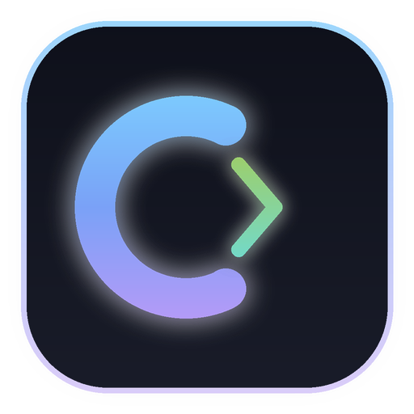

<p align="center">
  
</p>

<h1 align="center">C-Studio</h1>

<p align="center">
  <b>Modern, Hafif ve Çevrimdışı Akıllı C Programlama IDE'si</b><br>
  <i>Smart, Lightweight & 100% Offline C Development Environment</i>
</p>

<p align="center">
  
  
  
  
  
  
</p>

---

## 🚀 Proje Hakkında / About The Project

**C-Studio**, C dili öğrenen öğrenciler, eğitimciler ve yazılımcılar için geliştirilmiş modern, hızlı ve taşınabilir (portable) bir masaüstü entegre geliştirme ortamıdır (IDE).

Hiçbir karmaşık ortam değişkeni (Path), Visual Studio veya harici derleyici kurulumu gerektirmeden, **tek bir klasörden doğrudan çalışır**. İçerisinde dahili **TCC (Tiny C Compiler)** derleyicisi ve **llama.cpp** destekli **100% yerel çalışan Qwen 2.5 Coder 1.5B** yapay zeka asistanı barındırır.

---

## ✨ Temel Özellikler / Key Features

- ⚡ **Dahili C Derleyicisi (TCC 64-bit):**
  - Sıfır kurulum: Flash bellekten dahi doğrudan çalıştırılabilir.
  - `F5` tuşu ile milisaniyeler içinde tek tıkla derle ve çalıştır.
  - Çift tamponlama yaması (`cstudio_runtime.h`) ile `printf` ve `scanf` çıktıları anında ekrana yansır.

- 🖥️ **İnteraktif Canlı Terminal:**
  - Canlı `stdout` ve `stderr` akışı.
  - Kullanıcıdan klavye girdisi (`scanf`, `getchar`) alma ve terminal kontrol butonları (Çalıştır, Durdur, Temizle).

- 🤖 **100% Çevrimdışı Yapay Zeka Asistanı (Qwen 2.5 Coder 1.5B):**
  - İnternet bağlantısı, API anahtarı veya kota gerektirmez.
  - Kodlama ve C dili dışındaki soruları filtreleyerek tamamen yazılım odaklı eğitim verir.
  - Asistanın önerdiği kod bloğunu tek tıkla doğrudan editöre uygulama imkânı.

- 🛠️ **Akıllı Hata Çözüm Paneli (Smart Error Advisor):**
  - Derleyici hatalarını satır satır ayrıştırır.
  - Hatanın **Nerede** olduğunu, **Neden** kaynaklandığını ve **Nasıl Düzeltileceğini** açıklar.
  - Noktalı virgül eksikliği, kütüphane eksikliği ve parantez hataları gibi yaygın sorunlar için **Tek Tıkla Otomatik Düzeltme (Auto-Fix)** sunar.

- ⌨️ **Hızlı Tuşlar Çubuğu (Special Keys Bar):**
  - Türkçe klavyelerde yazması zor olan karakterleri (`{}`, `[]`, `\`, `|`, `~`, `->`, `;`) tek tıkla imleç konumuna ekler.

- 🌐 **Tam İki Dilli Arayüz (Türkçe & English):**
  - Arayüz, terminal mesajları, hata çözümleri ve yapay zeka asistanı tek tıkla Türkçe ve İngilizce arasında senkronize olarak değiştirilebilir.

- 📁 **Proje ve Dosya Yönetimi:**
  - Birden fazla projeyi yönetme, yeniden adlandırma ve klasörden açma.
  - `.c` kaynak dosyaları ve `.h` başlık dosyaları oluşturma, içe aktarma (Import) ve dışa aktarma (Export).
  - Hazır başlangıç şablonları (Boş, Merhaba Dünya, Hesap Makinesi, Sayı Tahmin Oyunu, Diziler & Döngüler, Struct & Bellek Yönetimi).

- 💾 **Akıllı Otomatik Kayıt (Auto-Save):**
  - Kod yazarken değişiklikleri otomatik olarak diske kaydeder, olası sistem kapanmalarında veri kaybını önler.

---

## 🛠️ Kaynak Koddan Derleme / Building from Source

### Gereksinimler
- [Flutter SDK](https://flutter.dev) (v3.13+ veya daha yenisi)
- Windows 10/11 x64
- Visual Studio 2022 (C++ Masaüstü Geliştirme araçları ile)
- Git

### Adımlar

1. Depoyu klonlayın:
   ```bash
   git clone https://github.com/EmirCakir7/C-Studio.git
   cd C-Studio
   ```

2. Bağımlılıkları yükleyin:
   ```bash
   flutter pub get
   ```

3. GGUF Yapay Zeka Modelini edinin:
   - [Qwen 2.5 Coder 1.5B Instruct GGUF](https://huggingface.co/Qwen/Qwen2.5-Coder-1.5B-Instruct-GGUF) modelini indirin:
     `qwen2.5-coder-1.5b-instruct-q3_k_m.gguf`
   - Dosyayı `ai/models/` klasörünün içine yerleştirin.

4. Uygulamayı çalıştırın veya derleyin:
   ```bash
   # Geliştirme modunda çalıştırmak için
   flutter run -d windows

   # Dağıtım (Release) sürümü oluşturmak için
   flutter build windows --release
   ```

---

## 📂 Dizin Yapısı / Architecture

```
C-Studio/
├── lib/
│   ├── models/            # Proje, derleyici ve hata modelleri
│   ├── services/          # Derleyici, yerel AI, dil ve otomatik kayıt servisleri
│   ├── widgets/           # Editör, terminal, yapay zeka paneli, proje gezgini
│   └── main.dart          # Ana IDE çalışma alanı ve pencere kontrolü
├── assets/
│   └── icons/             # Uygulama logosu ve grafik varlıkları
├── ai/
│   ├── runtime/           # llama-server.exe ve CPU mimarisi DLL dosyaları
│   └── models/            # GGUF yapay zeka model dosyaları
├── compiler/              # Taşınabilir TCC (Tiny C Compiler) ve C başlıkları
└── windows/               # Windows C++ Runner, pencere yapılandırması ve kaynaklar
```

---

## 🎖️ Atıflar ve Teşekkürler / Attributions & Acknowledgements

C-Studio, açık kaynak dünyasındaki güçlü projeler, kütüphaneler ve topluluklar üzerine inşa edilmiştir. Katkılarından ötürü aşağıdaki projelere ve geliştiricilerine teşekkür ederiz:

| Proje / Topluluk | Geliştirici / Kurum | Kullanım Alanı | Lisans |
| :--- | :--- | :--- | :--- |
| **[Tiny C Compiler (TCC)](https://bellard.org/tcc/)** | **Fabrice Bellard** & TCC Community | Dahili ultra-hızlı 64-bit C derleyicisi | [LGPL v2.1](https://www.gnu.org/licenses/old-licenses/lgpl-2.1.html) |
| **[llama.cpp](https://github.com/ggerganov/llama.cpp)** | **Georgi Gerganov** & llama.cpp Contributors | Çevrimdışı yerel yapay zeka çıkarım motoru (`llama-server`) | [MIT License](https://github.com/ggerganov/llama.cpp/blob/master/LICENSE) |
| **[Qwen 2.5 Coder](https://github.com/QwenLM/Qwen2.5-Coder)** | **Qwen Team / Alibaba Cloud** | Kod üretimi ve hata analizi sağlayan yapay zeka modeli | [Apache 2.0](https://github.com/QwenLM/Qwen2.5-Coder/blob/main/LICENSE) |
| **[Flutter](https://flutter.dev/)** | **Google** & Flutter Contributors | Modern, reaktif masaüstü kullanıcı arayüzü çerçevesi | [BSD 3-Clause](https://github.com/flutter/flutter/blob/master/LICENSE) |
| **[LLVM OpenMP (libomp)](https://openmp.llvm.org/)** | **LLVM Foundation** | Çok çekirdekli CPU paralelleştirme desteği | [Apache 2.0 with LLVM Exception](https://llvm.org/LICENSE.txt) |

---

## 👨‍💻 Geliştirici / Author

- **Emir Çakır**
  - GitHub: [@EmirCakir7](https://github.com/EmirCakir7)
  - Proje Bağlantısı: [https://github.com/EmirCakir7/C-Studio](https://github.com/EmirCakir7/C-Studio)

---

## 📄 Lisans / License

Bu proje **MIT Lisansı** altında lisanslanmıştır. Detaylar için [LICENSE](LICENSE) dosyasına göz atabilirsiniz.
Proje içerisinde kullanılan dahili üçüncü parti bileşenler (TCC, llama.cpp, Qwen modeli vb.) kendi yukarıda belirtilen açık kaynak lisanslarına tabidir.
